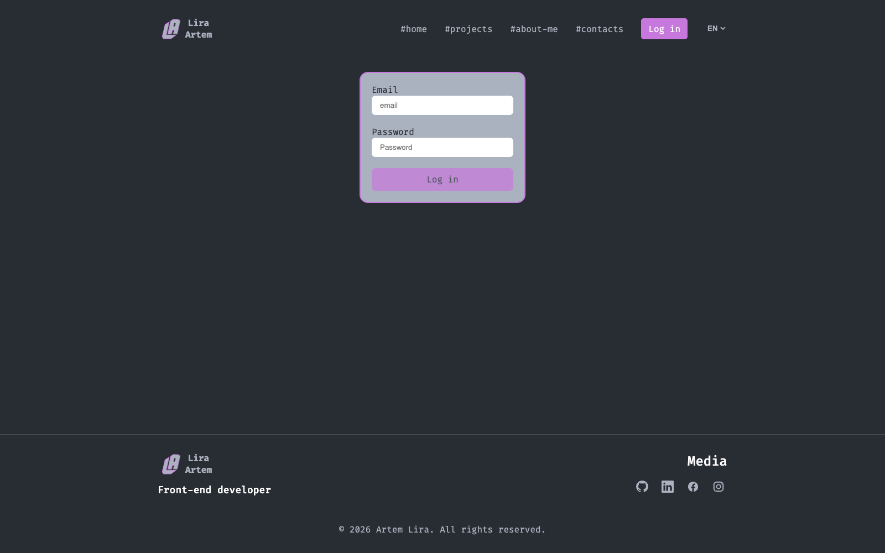
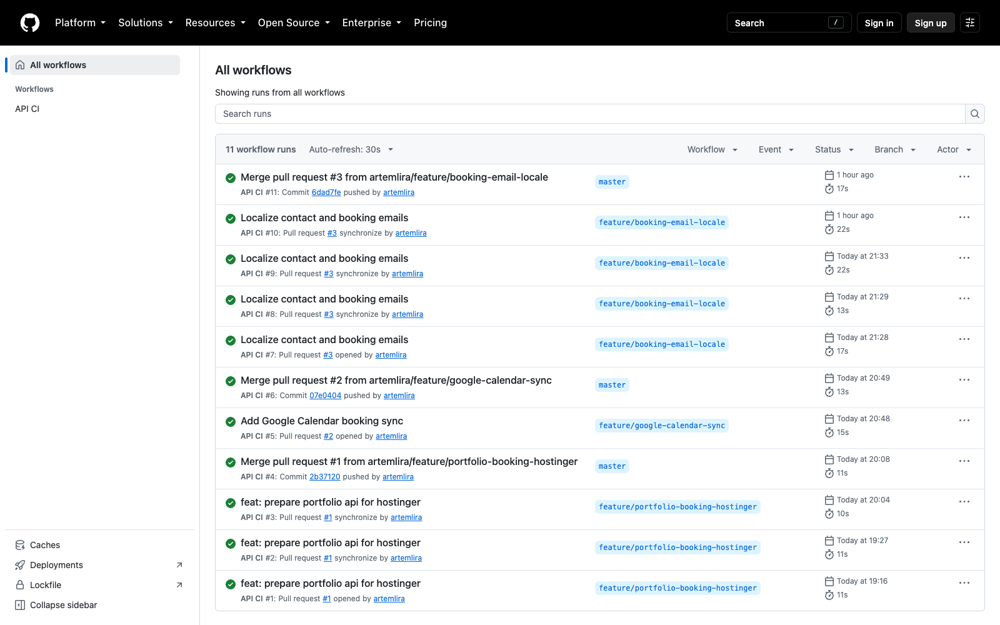
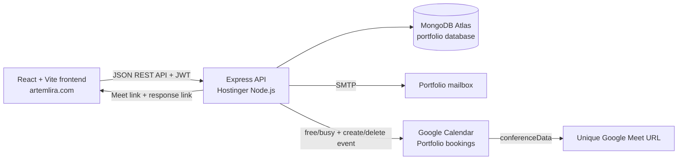

# Artem Lira Portfolio — Backend API

The Node.js/Express API for [artemlira.com](https://artemlira.com). It serves the portfolio frontend, stores editable content and bookings in MongoDB Atlas, protects admin operations with JWT authentication, sends contact and booking emails, and synchronizes meeting bookings with a dedicated Google Calendar to generate Google Meet links.

| | |
| --- | --- |
| Production website | [artemlira.com](https://artemlira.com) |
| Backend repository | [artemlira/MERN_Portfolio-back](https://github.com/artemlira/MERN_Portfolio-back) |
| Frontend repository | [artemlira/React-Portfolio_multipage](https://github.com/artemlira/React-Portfolio_multipage) |
| Frontend README | [Frontend architecture and UI](https://github.com/artemlira/React-Portfolio_multipage#readme) |
| Production hosting | Hostinger Node.js application, connected to MongoDB Atlas and the dedicated `Portfolio bookings` Google Calendar |

The browser never connects directly to MongoDB or Google APIs. The React app calls this API over HTTPS; this backend owns validation, authorization, persistence, email delivery, and Calendar operations.

## Screenshots

The booking UI is served by the companion frontend and demonstrates the API-backed booking workflow. The Actions view shows the backend repository's automated CI runs. Captured on October 18, 2026.

<p align="center"></p>
<p align="center"><em>The frontend asks this API for availability and submits the selected slot for validation and booking.</em></p>

<p align="center"></p>
<p align="center"><em>The companion frontend authenticates the owner before exposing protected API operations.</em></p>

<p align="center"></p>
<p align="center"><em>Backend CI checks pull requests and pushes to the repository's <code>master</code> branch; deployment is handled separately by the Hostinger setup.</em></p>

## System architecture



## Responsibilities and features

- **Portfolio data API:** public read endpoints and authenticated create/update/delete operations for projects, small projects, skills, facts, contact details, and social/media links.
- **Admin authentication:** validates credentials, hashes passwords with bcrypt, issues JWTs, and protects writes and booking-management endpoints.
- **MongoDB persistence:** Mongoose models and schemas for portfolio resources, users, and bookings; MongoDB Atlas is the production data store.
- **Booking availability:** derives time slots from a configurable weekly schedule and timezone; applies a minimum notice and booking-window limit; excludes existing database bookings and Google Calendar busy periods.
- **Google Calendar and Meet:** creates one event per confirmed booking on the configured calendar, requests a Google Meet conference, waits for the generated URL, and deletes the event when the booking is cancelled.
- **Localized SMTP emails:** sends contact messages to the configured inbox; booking notifications go to the owner and visitor, with the visitor email localized according to the language used on the site.
- **Attendee response flow:** creates a random response token, stores only its hash, accepts a confirmed/declined answer until the meeting begins, and exposes the answer to the protected booking manager.
- **Request and platform safeguards:** CORS allowlist, Helmet headers, JSON/body size limits, express-validator rules, MongoDB ID validation, and rate limits on login, registration, contact, and write requests.
- **Operational endpoint:** `/health` reports API status and whether MongoDB is connected.

## Booking lifecycle

1. The frontend requests booking settings and calendar availability. The backend generates slots in `BOOKING_TIMEZONE`, checks them against existing MongoDB bookings, and queries free/busy only on the calendar identified by `GOOGLE_CALENDAR_ID`.
2. When the visitor submits a slot, the backend validates name, email, note, and timestamp, then rechecks that the slot is still available. This prevents stale calendar UI from booking a time that has since been taken. A unique index on the booking start time is a final concurrency guard.
3. The API creates a MongoDB booking with an unpredictable confirmation token whose SHA-256 hash is stored. It inserts a generic `Portfolio meeting` event into the shared calendar and asks Google to create a Meet conference. The API polls the event until Google returns the Meet URL.
4. Only after the calendar event and Meet URL have been saved does the API respond successfully. If calendar creation or Meet generation fails, it removes the partial event/booking and returns an error; it does not claim that an incomplete meeting was booked.
5. If SMTP is configured, Nodemailer sends an owner notification and a visitor confirmation. The visitor's message includes the Meet URL, the date and time formatted in the site language and configured timezone, and the link to confirm or decline. The owner email includes the visitor details and current attendance state. The contact form also sends a localized message directly to the configured inbox.
6. The response endpoint hashes the submitted token and finds the matching booking. It accepts `confirmed` or `declined` before the meeting start, saves the response and timestamp, and will not let a later request change an already-recorded choice. The frontend renders a localized response page; the admin booking page shows the result.
7. On cancellation, the authenticated admin endpoint deletes the associated Google Calendar event first and then the booking record. If email delivery fails after the booking is safely stored, the booking remains valid and the API reports `notificationSent: false` so the frontend can show a delivery warning.

Calendar events use a generic title/description and do not copy the visitor's name, email, or note into Google Calendar. The service account should be shared only on the `Portfolio bookings` calendar. The integration uses Calendar free/busy and event operations for that calendar; it does not need access to the owner's personal calendar or Google Meet accounts separately.

## Frontend integration and API contract

The paired [React/Vite frontend](https://github.com/artemlira/React-Portfolio_multipage) uses Axios for API requests, Redux Toolkit for resource/auth state, React Router for routes, and `VITE_API_URL` to select the API origin. It submits the selected site locale with contact and booking requests so outbound mail follows the visitor's language.

### Health and authentication

```text
GET  /health
POST /auth/login
GET  /auth/me                 Authorization: Bearer <JWT>
```

Public registration is disabled. Only an existing administrator account can sign in.

### Portfolio reads and management

All listed collection routes use `GET` for public reads. `POST`, `PATCH`, and `DELETE` require a valid JWT.

| Resource | Routes |
| --- | --- |
| Projects | `GET/POST /projects`, `GET/PATCH/DELETE /projects/:id` |
| Small projects | `GET/POST /small`, `GET/PATCH/DELETE /small/:id` |
| Skills | `GET/POST /skills`, `GET/PATCH/DELETE /skills/:id` |
| Facts | `GET/POST /facts`, `GET/PATCH/DELETE /facts/:id` |
| Contacts | `GET/POST /contacts`, `GET/PATCH/DELETE /contacts/:id` |
| Media/social links | `GET/POST /medias`, `GET/PATCH/DELETE /medias/:id` |

The visitor contact form is separate from editable portfolio contact details:

```text
POST /contact                Public, rate limited; submits an email to the owner
```

### Bookings

```text
GET    /bookings/config
GET    /bookings/availability?month=YYYY-MM
GET    /bookings/availability?date=YYYY-MM-DD
POST   /bookings             Public booking request
POST   /bookings/respond     Public response token + confirmed/declined answer
GET    /bookings             Authenticated admin list
DELETE /bookings/:id         Authenticated cancellation and Calendar cleanup
```

See [BOOKING_SETUP.md](./BOOKING_SETUP.md) for the booking schedule, Google Cloud service account, Calendar sharing, and Hostinger configuration steps.

## Technology

| Area | Technologies |
| --- | --- |
| Runtime and server | Node.js (20+), JavaScript ES modules, Express 4 |
| Data layer | MongoDB Atlas, Mongoose 7 |
| Identity | JSON Web Tokens, bcrypt |
| Input validation | express-validator, custom MongoDB ID validation and error middleware |
| Security and traffic controls | Helmet, CORS, express-rate-limit, Express body-size limits |
| Mail | Nodemailer, configurable SMTP |
| Calendar | Google Calendar API via `googleapis`, service-account credentials |
| Configuration | dotenv and environment-based settings |
| CI | GitHub Actions, Node.js 22, npm |
| Production process | `hostinger.js` persistent HTTP server on Hostinger |

## Repository structure

```text
config.js                   Environment variables and booking defaults
index.js                    Express app, middleware, MongoDB connection, REST routes
hostinger.js                Persistent HTTP server entry point for Hostinger
controllers/                Auth, bookings, contacts, facts, media, projects, skills
models/                     Mongoose schemas, including Booking and User
utils/checkAuth.js          JWT middleware for protected endpoints
utils/email.js              Localized contact and booking email delivery
utils/googleCalendar.js     Free/busy lookup, event creation, Meet polling and deletion
utils/                      Shared auth/validation response helpers
validations.js              express-validator request schemas
uploads/                    Existing image files served from the API's /uploads path
.env.example                Safe environment-variable template (placeholders only)
BOOKING_SETUP.md            Booking and Google Calendar operations guide
.github/workflows/ci.yml    Backend CI checks
```

Portfolio resources are stored in MongoDB collections with one Mongoose model/controller per resource. Bookings have a unique `startAt`, Calendar event ID and Meet URL, attendee response fields, and a non-public confirmation-token hash. User password hashes are excluded from ordinary model reads.

## Local development

Use Node.js 20 or newer (Node.js 22 is used in GitHub Actions):

```bash
npm ci
cp .env.example .env
# Fill local-only credentials in .env
npm run dev
```

The local API listens on `http://localhost:4444` by default. The frontend should run separately and point `VITE_API_URL` to this origin. `npm start` runs the same persistent Hostinger entry point locally.

Useful scripts:

```bash
npm run dev       # nodemon index.js
npm start         # node hostinger.js
npm run check     # Node syntax checks for the API entry points and critical modules
```

## Environment configuration

Copy `.env.example` to a private local `.env` or enter the variables in Hostinger hPanel. The example file contains placeholders, not credentials.

| Variable | Purpose |
| --- | --- |
| `MONGODB_URI` or `MONGO_URI` | MongoDB Atlas connection URI including the `portfolio` database name. `DB_USER`, `DB_PASSWORD`, and `DB_NAME` are also supported as an alternative. |
| `JWT_SECRET` | Long random secret used to sign authentication tokens; required in production. |
| `JWT_EXPIRES_IN` | JWT lifetime; defaults to `30d`. |
| `CLIENT_ORIGINS` | Comma-separated allowed frontend origins; include `https://artemlira.com` and `https://www.artemlira.com` as needed. |
| `PORT` | Hostinger-provided listening port; defaults to `4444` for local use. |
| `SMTP_HOST`, `SMTP_PORT`, `SMTP_SECURE` | SMTP server and TLS settings. |
| `SMTP_USER`, `SMTP_PASS`, `MAIL_FROM` | Sender mailbox credentials and From address. |
| `CONTACT_TO_EMAIL` | Inbox for contact submissions and owner booking alerts. |
| `PUBLIC_SITE_URL` | Public frontend origin used in attendee response links; defaults to `https://artemlira.com`. |
| `GOOGLE_CALENDAR_ID` | ID shown in settings for the dedicated booking calendar. |
| `GOOGLE_CALENDAR_SERVICE_ACCOUNT_JSON` | Complete service-account JSON credentials stored as a private Hostinger variable. |
| `BOOKING_TIMEZONE` | IANA timezone for slot generation and email formatting; defaults to `Europe/Kyiv`. |
| `BOOKING_DURATION_MINUTES` | Meeting length; defaults to 30 minutes. |
| `BOOKING_MINIMUM_NOTICE_HOURS` | Minimum booking lead time; defaults to 24 hours. |
| `BOOKING_WINDOW_DAYS` | How far into the future visitors can book; defaults to 14 days. |
| `BOOKING_WEEKLY_HOURS` | JSON weekday-to-opening-hours map; see `.env.example` and `BOOKING_SETUP.md`. |

Never put production URIs, SMTP passwords, JWT secrets, or the Google service-account JSON in GitHub, frontend variables, or support messages. The Google Calendar private key belongs only in the backend's secret environment.

## Hostinger hosting, CI, and delivery

The production backend is a long-running Node.js app on Hostinger, not a browser-only service. Configure the Hostinger Node.js app to use the repository root, install dependencies with `npm ci` (or Hostinger's equivalent `npm install`), and start with `npm start`, which launches `hostinger.js` and binds to `0.0.0.0`. Configure all production environment variables in hPanel, including the migrated Atlas URI, mail settings, and Calendar credentials. No frontend assets are built by this backend.

The GitHub Actions workflow `.github/workflows/ci.yml` is **CI**: it runs for pull requests targeting `master` and pushes to `master`, uses Node.js 22, runs `npm ci`, then `npm run check`. The current check script validates JavaScript syntax for the app entry points and selected critical modules; it is not a unit/integration test suite and does not build or deploy the service.

The production delivery path is PR → successful API CI → merge to the deployment branch → Hostinger's connected Git deployment restarts/redeploys the Node.js app when that integration is enabled. GitHub Actions itself does not upload or restart the Hostinger application. Verify the source repository/branch and auto-deploy setting in hPanel if a merged commit does not appear in the running API.

The repository also contains a `vercel.json` compatibility entry point, but the production deployment documented for this portfolio is Hostinger (`npm start` → `hostinger.js`). The React frontend must be built separately and configured with the actual public URL of this Hostinger API using `VITE_API_URL`.

## Security and production considerations

- Protected writes require a valid JWT and the API also validates the request body; client-side route guards alone are not trusted.
- Public registration is disabled; `POST /auth/register` returns `404`. Keep administrator accounts provisioned outside the public API. The current JWT model has no role-based authorization, so do not add public account creation without an explicit administrator policy.
- Set a unique, high-entropy `JWT_SECRET` in production. Changing it invalidates all active tokens.
- Keep the service account shared only with the booking calendar, not the personal calendar. Rotate/revoke a key if it has ever been exposed.
- `CLIENT_ORIGINS` should contain only the deployed portfolio origins and explicitly needed local development origins.
- `npm run check` covers syntax, not behavior. Add dedicated API tests if the project grows or the booking contract changes.
